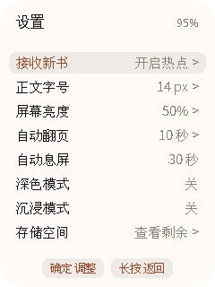
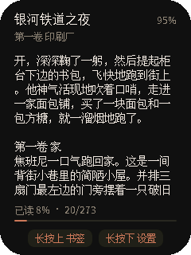
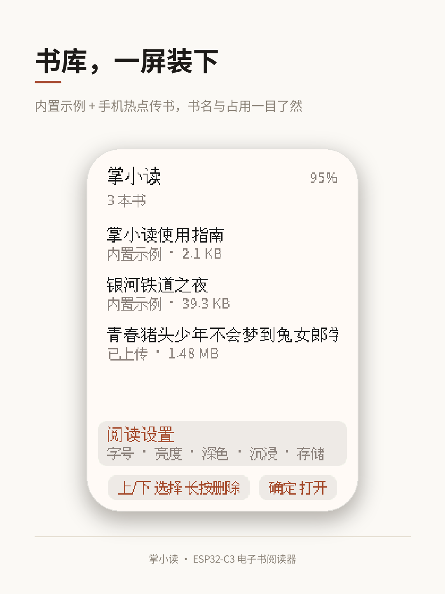
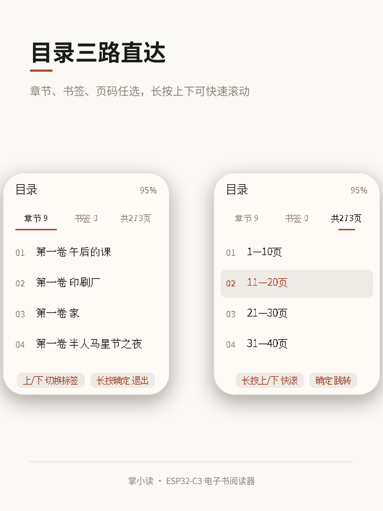
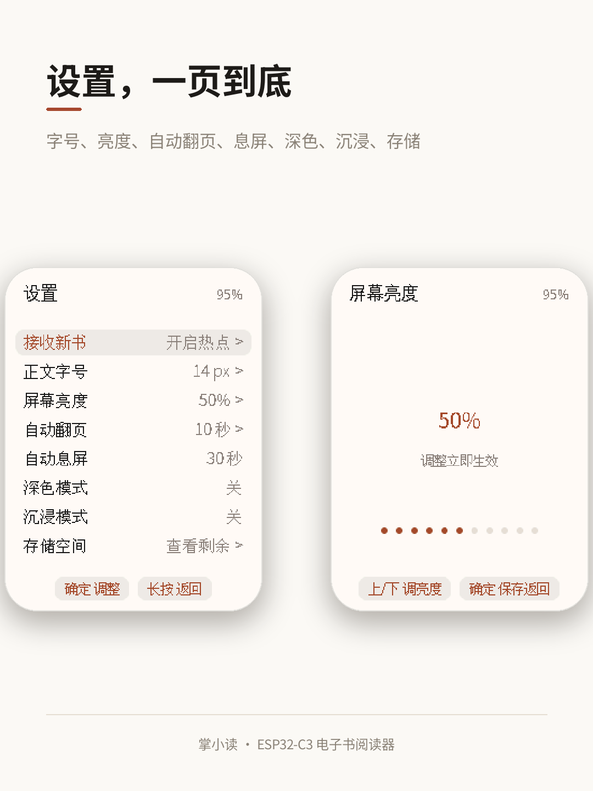
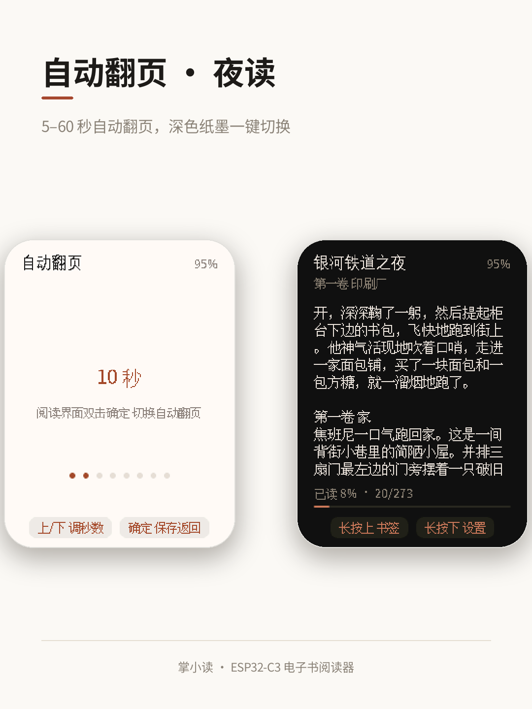

## 掌小读

> FOLOTOY 上的txt电子书阅读系统.

## 截图

| 首页 | 阅读 | 目录 · 页码 |
| --- | --- | --- |
|  |  |  |

| 设置 | 屏幕亮度 | 自动翻页 |
| --- | --- | --- |
|  |  |  |

| 封面 | 暗色 |
| --- | --- |
|  |  |

商店效果图（1080×1440，源文件在 `photo/store/`）：

    

## 特性

- **热点传书**：手机连设备热点，浏览器里选 `.txt` 即可传书，断线可续传；书名按原文件名显示。
- **七档字号**（12/13/14/15/16/18/20 px）精确分页，页脚实时显示 `已读 42% · 3/30`。
- **目录三路定位**：章节、书签、页码（10 页一档）三个标签，进入即落在当前位置；长按上下快滚。
- **亮度 11 档**（5%–100%）与**自动翻页 5–60 秒**，都在各自的刻度页上直接调，阅读界面双击确定随时开关自动翻页。
- **纸墨双色 + 沉浸模式**，沉浸模式把整屏留给正文。
- 书签（带原文摘录）、阅读进度、最近翻页记录都会持久化；存储页实时查看剩余空间。

## 书格式（.zdx）

内置书和上传书统一存成 `.zdx`：UTF-8 文本按 16 KiB 分块，每块独立 raw-deflate
压缩。`reader_store_read()` 对外仍按**原始**字节偏移读，所以分页、书签、目录跳转和
阅读进度与未压缩时完全一致。块大小同时是 deflate 的 LZ77 窗口：4 KiB 块只能压到原
大小的 55.3%，16 KiB 到 51.2%（32 KiB 是 50.6%，但要双倍字典缓冲）。旧固件写的 4 KiB
书仍能读，重新上传即按新块大小压缩。

二进制布局（小端；表中偏移是绝对文件偏移）：

| 范围 | 字段 | 含义 |
| --- | --- | --- |
| 0..3 | magic | `ZDX1` |
| 4 | version | `1` |
| 5 | flags | bit0 = raw deflate |
| 8..11 | chunk size | 16384（每块原始字节数，同时是 LZ77 窗口；解码器接受 1024–16384 的 2 的幂） |
| 12..15 | chunk count | deflate 流数量 |
| 16..19 | original size | 未压缩 UTF-8 字节数 |
| 20..23 | text chars | 非空白码点数（UI 提示用） |
| 32.. | chunk table | `count` 个 `{u32 offset, u32 length}` |
| ... | chunk data | 依次拼接的 raw-deflate 流 |

- **转换在浏览器里完成**：热点没有外网，`assets/web/transfer.html` 用内联 pako
  （`raw: true, windowBits: 14, level: 9`，16 KiB 一块）分块压缩后上传。网页显示书库当前可上传
  的压缩包大小，设备在写入前重新检查剩余空间并预留文件系统开销。原始 `.txt` 可超过
  2 MB，转换速度和可处理的大小取决于浏览器及设备内存。
- **打开大书**：首次扫描显示目录进度。上传书的目录、最近翻页记录与页数索引会写入
  书库缓存，再打开时直接复用（同一字号/沉浸档位下不再重算页数）；替换或删除书籍会
  清除相关缓存。
- **补字库**：保留七套主字形（12/13/14/15/16/18/20 px），共用文泉驿点阵宋体的 16 像素 GB2312 二级汉字补字库。
  缺字时按当前字号渲染，补字数据存于应用分区。上传仍缺字的书时，网页会列出部分字符及
  Unicode 码点。用 `tools/gen_reader_fallback.py` 和文泉驿的 `wenquanyi_12pt.bdf` 可重新生成。
- **内置书**：`assets/books/*.txt` 是唯一原文，`tools/gen_builtin_books.py` 生成
  `main/builtin_books_data.c`；设备用 `reader_zdx_open_mem()` 直接读 Flash 镜像，
  不占额外 RAM。字体生成器也扫描这些 `.txt`，保证内置书用到的字都有字形。
- **解码**：`components/uzlib/`（uzlib tinflate，zlib 许可）。无 PSRAM，每个解码器
  用固定缓冲（16 KiB 字典 / 4 KiB 回看窗口 / 2 KiB 压缩输入，约 22 KiB）。压缩输入
  按需从 Flash 流式补入，块内随机读从块首重新展开（一页约 8 KiB 的典型开销），所以
  书签与目录跳转仍然是「一个块」的代价，不是整本书。
- **参考实现与测试**：`tools/zdx_codec.py` 是字节布局的参考编解码器；
  `tests/test_reader_zdx.py` 用固件同一份 `main/reader_zdx.c` + uzlib 跑往返、跳转、
  头部和截断校验。

## 使用

从 Release 中下载烧录即可。合并镜像 `FoloToy-AI-Passport-full.bin` 从 `0x0` 烧录，
浏览器烧录工具：<https://ai-passport.folotoy.cn/tools/web-flasher/>。

## 开发

板卡 ESP32-C3 / 8 MB Flash / ESP-IDF 5.5.3。构建与验证：

```bash
./tools/validate.sh --static    # 仓库检查 + host tests
./tools/validate.sh --firmware  # ESP-IDF 构建 + 合并镜像校验
./tools/validate.sh             # 完整门禁
```

工程规则（BSP 边界、LVGL 锁、中文字体、真机交付格式）见 `AGENTS.md`；AI 技能在
`skills/`。PR 和 `main` 推送只跑静态检查与主机测试。推送 `v*` 标签运行完整验证并
发布固件。在 Actions 手动运行 Release 工作流可构建未发版的固件包，上游同步也仅手动触发。
